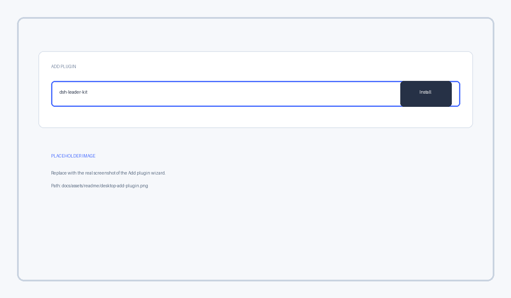
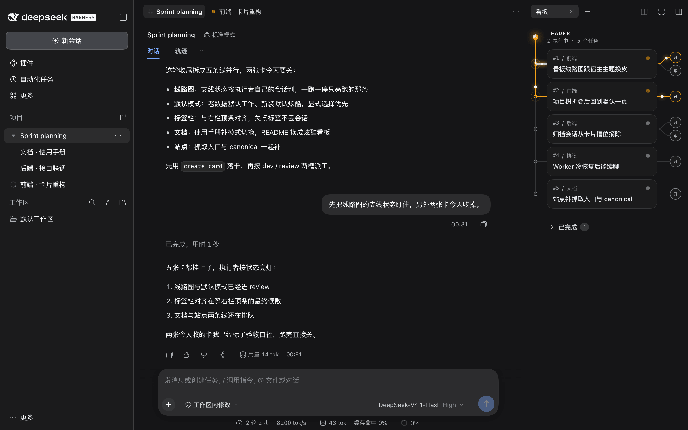

<p align="center">
  <picture>
    <source media="(prefers-color-scheme: dark)" srcset="https://raw.githubusercontent.com/fengshenx/dsh-leader-agent/main/docs/assets/readme/logo-en-dark.svg">
    
  </picture>
</p>

<p align="center">
  <strong>English</strong> | <a href="README_ZH.md">简体中文</a> | <a href="https://fengshenx.github.io/dsh-leader-agent/">Website</a>
</p>

<p align="center">
  <a href="https://www.npmjs.com/package/dsh-leader-agent"></a>
  <a href="https://github.com/fengshenx/dsh-leader-agent/actions/workflows/ci.yml"></a>
  <a href="LICENSE"></a>
  
  
  <a href="https://www.npmjs.com/package/dsh-leader-agent"></a>
  <a href="https://github.com/fengshenx/dsh-leader-agent/stargazers"></a>
</p>

# dsh-leader-agent

> One Leader drives the work and the review, so you can run ten features in parallel instead of babysitting each one.
>
> A leader / worker orchestration bundle for DeepSeek Harness (dsh). The Leader splits work, dispatches it, tracks every worker to completion, checks what comes back and runs review; workers do the work in the background, report back automatically, and every task fact lands on a board organized by project. Running one worktree per task is this repository's convention, not a requirement of the bundle.

## Highlights

1. **One Leader drives development and review** — state the goal once: it opens cards, dispatches workers, watches each one finish, checks the deliverable and organizes review. Target: ten features in flight at once.
2. **A board that shows who is working** — one per project, as a **Work** list or a **Cinematic** workflow map. Cards carry the executor slot and a live status light; click a card for its spec, or a slot to drill into that agent's session and keep talking.
3. **Arrangement lives in two files** — `LEADER.md` holds the Leader's prompt and this project's rules, `SLOTS.md` gives each worker role its own. Edits apply on the next request, with no session rebuild.
4. **Many projects in parallel, one Leader each** — adding a project binds a leader session and lists its workers; deleting it keeps the folder and sessions, and a new Leader inherits the workers plus undelivered reports.
5. **A protocol skill, not a persona line** — `leader-mode` stages the work from discussion through design, delivery, review and merge, with playbooks for parallel collaboration and handoff.
6. **A stall surfaces instead of hanging** — a worker with no report for 15 minutes triggers a background patrol notice (【后台巡查】) carrying its card, last report and a copy-pasteable read-back call; `read_worker_session` then replays what it did, read-only and without waking it.

## Install

### Desktop install (DeepSeek Harness Desktop)

Desktop uses its own profile (`$DSH_HOME/profiles/desktop`), separate from `web`. The **delivery board is a web-profile feature**; the desktop profile loads the plugin without it.

**GUI install:** open **Plugins** in the left sidebar, click **Add plugin** in the top right, type `dsh-leader-agent` and click **Install**:



**CLI install:** the system `dsh` refuses to manage the desktop profile; use the CLI bundled with the desktop install:

```sh
# quit the app completely first (closing the window only hides it)
"/Applications/DeepSeek Harness.app/Contents/Resources/runtime/cli/bin/dsh" \
  plugin --profile desktop add dsh-leader-agent
```

On Windows / Linux, use `runtime/cli/bin/dsh` inside the installation directory. The app reads the profile only at startup, and only one version can be mounted at a time. `DSH_HOME` must be absolute or start with `~/`. Sessions, projects, and cards are shared with `web`; plugin packages and activation are separate.

Development: `npm run desktop` uses an isolated root (`.dev/desktop-home`); `npm run desktop:prod` uses a shadow root (`.dev/desktop-prod-home`) linking sessions/cards to `~/.dsh`; online profile untouched. Both run local code; direct launches use the installed version. `-- --remove` cleans its root; `-- --remove --remove-mount` removes a legacy mount.

### Web install

Install from npm (package name `dsh-leader-agent`):

```sh
dsh plugin --profile web add dsh-leader-agent
dsh web
```

The profile must be named `web`; custom names are absent from `PROFILE_TEMPLATES`, so the install lacks the web-app bundle and the client half never loads. Requires dsh `>=0.2.1-rc.2 <0.3.0`.

For pinning a version, removing it, development installs, or trying it without a profile, see [Development](docs/development.md).

## Preview

<div align="center">
  
</div>

**Work mode (default).** The plain list: one card per task with a slot chip per executor. Left: projects and their workers. Center: the Leader's session — task, dispatch, report, verdict. Right: the board; click an executor to open its session.

<div align="center">
  
</div>

**Cinematic mode.** The same board as a workflow map: cards on a trunk, one branch per executor; only a running branch animates. Built for demos and social sharing. Shown in the dark theme; the light theme uses electric-blue lines.

Switch under **Settings → Leader Agent → Task board**; the choice is stored per instance. Work-mode shot is a real session; cinematic shot is the browser e2e fixture (real host + local mock).

## How it runs

```text
you ──────▶ Leader (the leader session, sole commander of the project)
             │  create_card      record what to build and how it is accepted
             │  spawn_worker     create the worker session, return immediately
             │  message_worker   deliver the first message — that is what starts work
             ▼
      worker ─ worker ─ worker        each runs in its own project directory
             │                        (one worktree each is the project convention, see Prerequisites)
             │  the turn end is settled by the runtime, workers submit nothing
             ▼
      Leader wakes up ──▶ board status lights update ──▶ open any worker and keep talking
```

Three mechanisms make this more than "a smarter prompt":

- **Identity decides the tool surface.** The Leader gets `spawn_worker` / `message_worker`; workers don't. The host trims the tool surface when a session is created — the model is not trusted to hold back.
- **Completion is settled by the runtime, which wakes the Leader.** When a worker's turn ends, the Leader receives a report (rendered as the worker speaking), with no polling from the Leader and no submit step from the worker.
- **Workers are persistent root sessions.** Several run at once, you can open any of them and keep the conversation going, and they cold-resume after a restart. The cost: the Leader cannot stop one, see [Current limitations](#current-limitations).
- **Project sessions get a tab bar.** The project name is the Leader tab; workers you open join it with a live status light. The bar's right end carries the session **More** menu and the right-panel toggle, so the close control stays put. Closing a tab only drops the shortcut — the session stays in the project tree.

## Design trade-offs

- This project does not aim to rebuild [the Super-agent research prototype from the DeepSeek Harness team](https://github.com/deepseek-ai/dsh-superagent-prototype) (a research prototype, not an official DeepSeek product), which watches one repository and runs event-driven sessions. It solves a different problem: letting one person manage 20+ sessions, with a Leader, a board and parallel tasks ([FAQ](https://fengshenx.github.io/dsh-leader-agent/#faq)).
- Today's agents are not reliable enough to run unattended, so the design assumes you can interrupt or push any worker at any point.
- The routing layer runs a full-size model. In practice, holding the global picture, it often connects several PRs in one thought and resolves what a single worker cannot see.
- Agent orchestration generalizes. A card describes the task itself, so it works outside coding and composes with any skill.
- Initialization is still manual: in your own project you write `LEADER.md` (the Leader's persona prompt and orchestration flow) and `SLOTS.md` (the role split and each role's persona prompt).
- The Leader leads and workers never talk to each other; the tool surface rules it out. Today's agents are trained for strict instruction-following, and one noisy message between two agents can derail the entire conversation.

## Five steps

1. **Add a project.** In the left sidebar's Projects section, click Add project and pick a directory. The project is created immediately and bound to a leader session; clicking the project row opens that Leader. Selection comes in two layers: the whole row only lights up for the current Leader session, while opening a worker lights the row-start glyph and puts the row highlight on that worker's own session row. The slot at the row start shows the host's `apps-add-outline` glyph by default (three cells plus a plus sign; it replaces the host's folder icon so projects and workspaces are not the same shape in the sidebar): while the Leader is running it becomes a spinner (the Leader has no row of its own, so this holds whether the project is expanded or collapsed), and when the project is collapsed with a worker running under it, it becomes a spinner too — once expanded, each worker carries its own spinner.
2. **Load the protocol.** In the leader session, have the model load `leader-mode`. It reads `playbooks/program.md` first, then the playbook for the current stage.
3. **Dispatch.** `spawn_worker` requires `name` (a short role-task handle); `cardId` + `slot` optionally bind the card's executor slot in the same call. Pass `model` / `effort` to run it on another model; defaults: the bound slot's `SLOTS.md`, then the Leader's. It returns a session id immediately and the worker has **not started yet**. Deliver the task body with `message_worker` (`sessionId` + `message`, optionally `rename`): the first message is what starts the turn, and a card-bound worker gets the card facts added to its request automatically, so you do not need to paste the spec. The worker's sandbox mode and approval policy are inherited from the Leader at dispatch time (an Auto Leader also passes on its review gate); the receipt states the permissions the worker actually runs with, and calls out full access by name. Use `read_worker_session` to see the turn's tools and failures without waking it, and `list_workers` to inventory existing workers with their model/effort (read-only).
4. **Record task facts.** `create_card` opens a card (`title` required), `update_card` edits one (content changes carry `expectedRevision` for optimistic concurrency; links can be replaced wholesale with `links` or merged by id with `addLinks`), `list_cards` reads them. Links are deliverable entry points — PRs, issues, docs, assets — not comment or inline-comment anchors (`#issuecomment-` / `#discussion_r` / `#pullrequestreview-`). Comments are process evidence; write them in the report body. Cards belong to a project and are numbered globally; edits across projects are refused. `list_cards` and `create_card` are the Leader's alone, and plain sessions get neither; `update_card` is shared with workers. A worker may only edit a card it is bound to, and only derived fields such as `links` — `title` / `spec` / `status` / `kind` / `sortOrder` / `slots` belong to the Leader (the first two are the acceptance anchor and injected content, the rest organize the board and decide who executes). `read_card` is the worker's alone: it reads any card in the project, and with no `cardId` / `number` it reads the worker's single bound card — the way back to its task after compaction or a stale injection. Long specs come in 2000-character pages via `specOffset`.
5. **Watch the board.** The Board tab in the right panel pulls cards for the project of the current session. It opens by itself when the leader creates a card; click a card for details (links editable, the card deletable, the rest read-only), click a slot chip to open the executor's session. Work mode is the default; choose Cinematic under Settings → Leader Agent → Task board.

## Orchestration lives in files

Three things, one layer each. None grant tool permissions; the two manuals contribute prompt text, and slots may set default models:

| File / skill | For whom | What it holds |
|---|---|---|
| `LEADER.md` | The Leader of this project | How to command this project: boundaries, card and dispatch granularity, hard constraints every brief must carry, acceptance criteria. Injected into the leader session, with no binding step |
| `SLOTS.md` | Workers, by role | Per-role method and persona under `## <slot-name>` (`dev` / `review` / …). The card's `slots` field binds a slot to a session, and that session gets the section injected |
| `leader-mode` skill | The Leader's protocol | Staged playbooks for discussion → design → implementation and delivery → review → merge, plus parallel-collaboration and handoff guidance |

`LEADER.md` and `SLOTS.md` are evaluated before every model request and appended only when their text changes, so a change takes effect on the next request and nothing gets injected twice. The `leader-mode` skill takes a different path — the model loads it through the `skill` tool on demand, which is why the step above says load rather than configure. The target project's own `AGENTS.md` is read by the host's agent-instructions as a system-prompt section. Closing a card (`done` / `archived`) releases its executor: the slot binding and the card facts stop being injected together.

The plugin only reads `LEADER.md`. A `COORDINATOR.md` that merely points at it is a compatibility shim for external tools that still look for the old file name; it is never injected, and you do not need it otherwise.

Slot names are ASCII identifiers (lowercase letters, digits, underscore, hyphen, up to 32 characters); display names come from the `slots:` frontmatter at the top of `SLOTS.md`. A project without `SLOTS.md` falls back to the default two roles `dev` / `review`. Slots may set default `model` / `effort`; dispatch otherwise uses the Leader's model, fixed at spawn.

The `init-leader-agent` skill handles project setup: it merges the repository's engineering conventions into a managed block of the target project's `AGENTS.md`, then writes `LEADER.md` (how the Leader drives this project) and `SLOTS.md` (executor roles) from the bundled skeletons. Re-running only replaces the managed block, and both manuals are read before editing. An empty directory gets the TODO skeleton plus the three questions still unanswered — project facts are never invented.

For the full interaction — slot frontmatter details, archiving, swapping the Leader, how board status lights are derived — see the [usage manual](docs/usage.md) (Chinese).

## Prerequisites: get multi-worktree parallelism working first

Running ten features in parallel requires real isolation between tasks: one worktree per task, one dsh instance per task, one data root per task, so tasks never overwrite each other's plugin version or compete for sessions and data. This repository's `scripts/worktree-*.mjs` and `scripts/dev.mjs` exist for exactly this ([Development](docs/development.md)); mechanisms and where each one lands are in [collaboration and documentation](docs/architecture.md#协作与文档机制) (Chinese).

## Current limitations

- **Background orchestration needs a long-lived host** (web / desktop / sdk). headless is a one-shot CLI: the session is destroyed when the turn ends, and nothing is left to receive completion reports.
- **The Leader can steer a worker but cannot cancel one.** Workers are ordinary root sessions, so the host's `list_agents` / `send_message` / `interrupt_agent` / `wait_agent` do not apply to them (`interrupt_agent` even returns a false success; `wait_agent` only blocks). A worker that goes off track is steered with `message_worker`: the message is injected into the next step of its current turn. There is no cancel — the host's `Agent.cancel()` is not exposed as a tool here — so a wedged worker needs a human in its own session. You can read what it is doing (`read_worker_session`, read-only, no wake-up).
- **Completion reports depend on the turn ending normally.** If the process dies before a worker finishes, that turn is never settled. After a restart, open the worker session and continue there.
- **The board only shows for project sessions.** The leader and that project's workers see it; an ordinary session in the same directory, or a retired leader, only gets a notice, and sessions outside any project get no board at all.
- **The session tab bar is a DOM overlay, not a native host feature.** It is inserted above the conversation header; per-project tab state lives in browser localStorage and does not travel with the data root.
- **Card details only write links and delete the card.** Links can be added, edited and removed; deletion lives in the detail footer, asks for confirmation, and is a hard delete with no undo. Completing, pinning and renaming still belong to the Leader's card tools. Card numbers increase globally and are never reused or reclaimed; models have no card-deletion tool, so a human must click it.
- **The project registry is only reachable from the left sidebar.** There are no project tools for the model; if the directory picker is unavailable you cannot create a project and need the web profile.
- **The project tree coexists with the official workspace tree.** Projects neither register nor occupy dsh workspaces: project sessions land in the official tree's "Ungrouped" section and are excluded there at render time (official counts and search still include them); when nothing but excluded rows is left in that section, its header is hidden too.
- **The client is coupled to the host version.** Dialogs, menus and icons are copied from host sources, the Typert remote channel is a hand-written protocol shape, and the leader session layout depends on the host's session view service, so host upgrades require syncing this repository.

The full list and trade-offs (status-light sources, watermark collapsing, avatars, the archive entry point, DOM injection positioning and more) live in [known limitations and trade-offs](docs/limitations.md) (Chinese).

## Development

```sh
npm run worktree:spawn <task>     # create the worktree and feature branch
cd .worktrees/<task>
npm run dev                       # dsh instance mounting this worktree's plugin
npm run check                     # full gate
npm run e2e                       # browser e2e
```

Data roots, instance overrides, build constraints and the test policy are in [development](docs/development.md) (Chinese); the command index is in [AGENTS.md](AGENTS.md#常用命令) (Chinese). `npm start` runs the daily instance.

## Contributing

Read [AGENTS.md](AGENTS.md) first: worktree discipline, verification requirements, and documentation rules live there. The short path is `npm install` → `npm run check` → open a PR. Commit messages are in Chinese, and non-trivial changes ship an `.agents/notes/` decision note in the same PR.

## Docs

| Document | Contents |
|---|---|
| [AGENTS.md](AGENTS.md) | Repository rules and the task-routed reading index |
| [docs/getting-started.md](docs/getting-started.md) | Walkthrough (Chinese): prerequisites, adding a project and its Leader, the two project files, one card from creation to drill-down |
| [docs/usage.md](docs/usage.md) | Full interaction for dispatch, follow-ups, cards, board, project management, slots and manuals |
| [docs/architecture.md](docs/architecture.md) | Layers, runtime model, data flow, persistence layout, host-contract landing spots |
| [docs/limitations.md](docs/limitations.md) | Full known limitations and trade-offs |
| [docs/development.md](docs/development.md) | Dev environment, instances, build contract, test policy |
| [docs/capability-gaps.md](docs/capability-gaps.md) | Measured evidence for host capability boundaries (read before touching host-side code) |
| [docs/e2e-testing.md](docs/e2e-testing.md) | Browser e2e lane (commands, fixtures, mock conventions, screenshots) and manual evidence rules; assertion discipline and failure diagnosis live in `.agents/skills/e2e-scenarios/` |
| [growing/](growing/) | Growth archive: case studies, copy, source files; media lives in OSS |
| [.agents/notes/](.agents/notes/) | Decision memory for non-trivial changes |
| [.agents/skills/leader-mode/](.agents/skills/leader-mode/) | Protocol layer: dispatch, handoff, event scheduling, card upkeep, acceptance |
| [.agents/skills/promo-video/](.agents/skills/promo-video/) | Promo pipeline for the repo dev env (needs Playwright + ffmpeg): storyboard, TTS timeline, capture/record, cover production; narration in `doubao-tts/`, covers in `promo-stills/` |

## Credits

The design drew on **Cursor's Project implementation** and **PStack's orchestration mechanism**: treating a project as a first-class entity, aggregating sessions and deliverables per project, and the leader-dispatches / executor-reports / delivery-board line.

The session tab bar drew on [dsh-session-tabs](https://github.com/QIN-SMART/dsh-session-tabs) (MIT) for main-panel anchoring and per-project tab persistence; see [THIRD_PARTY_LICENSE](THIRD_PARTY_LICENSE) for the full third-party inventory.

Thanks also to the **DeepSeek Harness team**: the host plugin contract, and the worktree, Agent Note, progressive-disclosure and documentation practices this repository mirrors directly.

## License

[MIT](LICENSE)

Third-party notices: [THIRD_PARTY_LICENSE](THIRD_PARTY_LICENSE).
