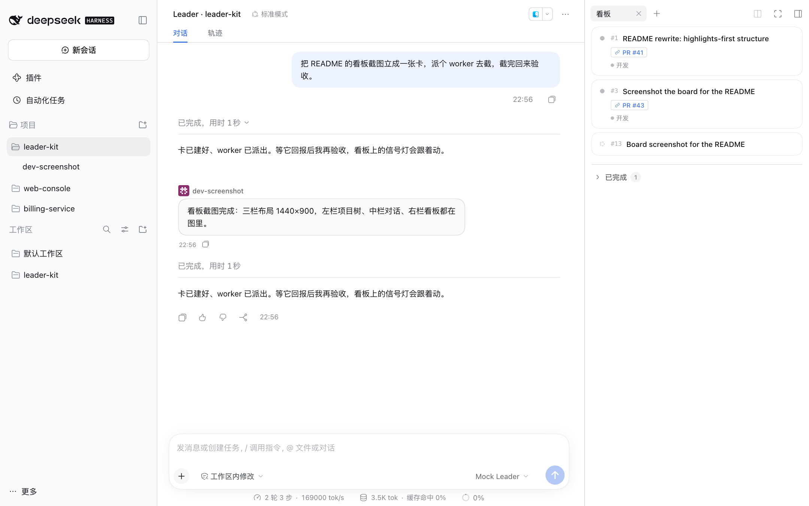

<p align="center">
  <picture>
    <source media="(prefers-color-scheme: dark)" srcset="docs/assets/readme/logo-en-dark.svg">
    
  </picture>
</p>

<p align="center">
  <strong>English</strong> | <a href="README_ZH.md">简体中文</a>
</p>

<p align="center">
  <a href="LICENSE"></a>
  
  
</p>

# dsh-leader-kit

> One Leader drives the work and the review, so you can run ten features in parallel instead of babysitting each one.
>
> A coordinator / worker orchestration bundle for DeepSeek Harness (dsh). The Leader splits work, dispatches it, tracks every worker to completion, checks what comes back and runs review; workers do the work in the background, report back automatically, and every task fact lands on a board organized by project. Running one worktree per task is this repository's convention, not a requirement of the bundle.

## Highlights

1. **One Leader drives development and review** — You state the goal once. The Leader opens cards, dispatches workers, watches each one finish, verifies the deliverable and organizes review. Your attention goes back to "what do I want" instead of "which agent is stuck"; the target is ten features in flight at once.
2. **A right SidePanel board: see who is working at a glance** — One board per project. Each card carries its executor slot and a live status light, its note renders as Markdown, and its links are editable in place. Click a card for the spec (goal, scope, acceptance, links), click a slot to drill into that agent's session and keep talking; worker reports arrive as the worker speaking, also Markdown-rendered.
3. **Arrange your agents however you want** — Two files do the arranging. `COORDINATOR.md` holds the Leader's prompt and this project's orchestration rules: boundaries, dispatch requirements, acceptance criteria. `SLOTS.md` gives each worker role its own rules (discuss / dev / review / …). Both are evaluated before every model request and appended only when their text changes, so editing a file changes behavior without recreating sessions.
4. **Many projects in parallel, one Leader each** — Adding a project binds a coordinator session to it, and the project tree lists the workers that Leader spawned; rows can be dragged to reorder, and deleting a project removes the workspace the plugin registered while keeping the folder and session records. Projects stay out of each other's way. Swap in a new Leader and the existing workers plus undelivered reports move over, so it can dispatch immediately.
5. **The `leader-mode` skill: an orchestration protocol for the Leader** — Not "you are a tech lead". Staged playbooks across discussion → design → implementation and delivery → review → merge, plus guidance on parallel collaboration and handoff.
6. **Read back what a worker did, without waking it** — `read_worker_session` reads a worker's session log directly and returns each turn's task, body, the tools it called and why anything failed. Read-only: it does not wake the worker and triggers no model call. The completion notice tells you what came out; this tells you how it got there, so debugging does not need another round.

## Preview

<div align="center">
  
</div>

Left: projects and the workers each Leader spawned. Center: the Leader's session — the task, the dispatch, the worker reporting back, the verdict. Right: the delivery board for the project, with one card per task and a slot chip per executor. You can see the agents that are working, click one to drill into its session and talk to it directly, without going through the Leader.

The screenshot shows a real working session.

## How it runs

```text
you ──────▶ Leader (the coordinator session, sole commander of the project)
             │  create_card      record what to build and how it is accepted
             │  spawn_worker     create the worker session, return immediately
             │  message_worker   deliver the first message — that is what starts work
             ▼
      worker ─ worker ─ worker        each runs in its own project directory
             │                        (one worktree each is the project convention, see Prerequisites)
             │  the turn end is settled by the runtime, workers submit nothing
             ▼
      Leader wakes up ──▶ board status lights update ──▶ open any worker and keep talking
```

Three mechanisms make this more than "a smarter prompt":

- **Identity decides the tool surface.** The Leader gets `spawn_worker` / `message_worker`; workers don't. The host trims the tool surface when a session is created — the model is not trusted to hold back.
- **Completion is settled by the runtime, which wakes the Leader.** When a worker's turn ends, the Leader receives a report (rendered as the worker speaking), with no polling from the Leader and no submit step from the worker.
- **Workers are persistent root sessions.** Several run at once, you can open any of them and keep the conversation going, and they cold-resume after a restart. The cost: the Leader cannot stop one, see [Current limitations](#current-limitations).

## Design trade-offs

- This project does not aim to rebuild dsh's own super agent. It solves one concrete problem: letting one person manage 20+ sessions.
- Today's agents are not reliable enough to run unattended, so the design assumes you can interrupt or push any worker at any point.
- The routing layer runs a full-size model. In practice, holding the global picture, it often connects several PRs in one thought and resolves what a single worker cannot see.
- Agent orchestration generalizes. A card describes the task itself, so it works outside coding and composes with any skill.
- Initialization is still manual: in your own project you write `COORDINATOR.md` (the Leader's persona prompt and orchestration flow) and `SLOTS.md` (the role split and each role's persona prompt).
- The Leader leads and workers never talk to each other; the tool surface rules it out. Today's agents are trained for strict instruction-following, and one noisy message between two agents can derail the entire conversation.

## Quick Start

### Install

Profile link for development (changes take effect on reload):

```sh
dsh plugin --profile web add ../dsh-leader-kit
dsh web
```

Try it without installing into a profile:

```sh
cd /path/to/deepseek-harness
pnpm dsh web --patch ../dsh-leader-kit/cordis.patch.yml
```

Once it is published to npm, install it by package name instead:

```sh
dsh plugin --profile web add dsh-leader-kit
```

The profile must be named `web`. The plugin manifest declares `platform: web`, and custom names such as `dev` are absent from dsh's `PROFILE_TEMPLATES`: `dsh plugin` would build that profile from the default template with only `@deepseek-ai/dsh-base` installed, so there is no web-app bundle and the client half of the plugin never loads.

`engines.dsh` declares the supported range (currently `>=0.2.1-rc.2 <0.3.0`); install and startup are refused outside it. dsh is in developer preview, so this range has to track it. Inside this repository you can run `npm start`: it builds `lib/client.js` first (the file is not committed, and a missed build still starts the instance with an empty right panel), then starts `dsh web` after checking that dsh is available and the daily profile has this plugin installed.

### Five steps

1. **Add a project.** In the left sidebar's Projects section, click Add project and pick a directory. The project is created immediately and bound to a coordinator session; clicking the project row opens that Leader (a workspace the plugin registered and you deleted is recreated on the click, with the sessions put back). Selection comes in two layers: the whole row only lights up for the current Leader session, while opening a worker lights the folder at the row start and puts the row highlight on that worker's own session row. The slot at the row start is a folder icon by default: while the Leader is running it becomes a spinner (the Leader has no row of its own, so this holds whether the project is expanded or collapsed), and when the project is collapsed with a worker running under it, it becomes a spinner too — once expanded, each worker carries its own spinner.
2. **Load the protocol.** In the coordinator session, have the model load `leader-mode`. It reads `playbooks/program.md` first, then the playbook for the current stage.
3. **Dispatch.** `spawn_worker` requires `name` (a short role-task handle); `cardId` + `slot` optionally bind the card's executor slot in the same call. It returns a session id immediately and the worker has **not started yet**. Deliver the task body with `message_worker` (`sessionId` + `message`, optionally `rename`): the first message is what starts the turn, and a card-bound worker gets the card facts added to its request automatically, so you do not need to paste the spec. The worker's sandbox mode and approval policy are inherited from the Leader at dispatch time (an Auto Leader also passes on its review gate); the receipt states the permissions the worker actually runs with, and calls out full access by name. To see how it went about this turn — which tools it called, where it failed — use `read_worker_session` on it; that does not wake the worker.
4. **Record task facts.** `create_card` opens a card (`title` required), `update_card` edits one (content changes carry `expectedRevision` for optimistic concurrency; links can be replaced wholesale with `links` or merged by id with `addLinks`), `list_cards` reads them. Cards belong to a project and are numbered globally; edits across projects are refused. `list_cards` and `create_card` are the Leader's alone, and plain sessions get neither; `update_card` is shared with workers. A worker may only edit a card it is bound to, and only derived fields such as `links` — `title` / `spec` / `status` / `slots` belong to the Leader (the first two are the acceptance anchor and injected content, the last two decide who executes and whether the card counts as done).
5. **Watch the board.** The Board tab in the right panel pulls cards for the project of the current session. It opens by itself when the coordinator creates a card; click a card for details (links editable, the rest read-only), click a slot chip to open the executor's session.

## Orchestration lives in files

Three things, each covering one layer. All of them contribute prompt text only and grant no tool permissions:

| File / skill | For whom | What it holds |
|---|---|---|
| `COORDINATOR.md` | The Leader of this project | How to command this project: boundaries, card and dispatch granularity, hard constraints every brief must carry, acceptance criteria. Injected into the coordinator session, with no binding step |
| `SLOTS.md` | Workers, by role | Per-role method and persona under `## <slot-name>` (`discuss` / `dev` / `review` / …). The card's `slots` field binds a slot to a session, and that session gets the section injected |
| `leader-mode` skill | The Leader's protocol | Staged playbooks for discussion → design → implementation and delivery → review → merge, plus parallel-collaboration and handoff guidance |

`COORDINATOR.md` and `SLOTS.md` are evaluated before every model request and appended only when their text changes, so a change takes effect on the next request and nothing gets injected twice. The `leader-mode` skill takes a different path — the model loads it through the `skill` tool on demand, which is why the step above says load rather than configure. The target project's own `AGENTS.md` is read by the host's agent-instructions as a system-prompt section. Closing a card (`done` / `archived`) releases its executor: the slot binding and the card facts stop being injected together.

Slot names are ASCII identifiers (lowercase letters, digits, underscore, hyphen, up to 32 characters); display names come from the `slots:` frontmatter at the top of `SLOTS.md`. A project without `SLOTS.md` falls back to the default three roles `discuss` / `dev` / `review`.

The `init-project` skill does something else: it merges the repository's engineering conventions (worktree discipline, verification requirements, documentation rules) into a managed block of the target project's `AGENTS.md`. The write takes effect for later sessions immediately, re-running only replaces the managed block, and it never overwrites the project's own content.

For the full interaction — slot frontmatter details, archiving, swapping the Leader, how board status lights are derived — see the [usage manual](docs/usage.md) (Chinese).

## Prerequisites: get multi-worktree parallelism working first

Running ten features in parallel requires real isolation between tasks: one worktree per task, one dsh instance per task, one data root per task, so tasks never overwrite each other's plugin version or compete for sessions and data. Without that layer, the work the Leader dispatches tramples a single checkout, and the board is just a pile of sessions sharing one workspace. This repository's `scripts/worktree-*.mjs` and `scripts/dev.mjs` exist for exactly this ([Development](#development)).

We recommend adopting the four engineering practices of the DeepSeek Harness team; this bundle is built on the same ideas:

- **Worktree parallelism.** Tasks live in their own checkout, the dev instance gets its own data root, and the main branch stays untouched until merge.
- **Agent Notes.** Non-trivial changes ship a decision note in the same PR, recording permanent decisions and boundaries only, never a play-by-play.
- **Progressive disclosure in `AGENTS.md`.** The root file holds only rules that apply to every task plus a task-routed index; details live in their own documents.
- **Documentation that resists rot.** Whatever can be checked mechanically runs in `npm run check`; behavior changes update the docs in the same PR; temporary evidence never enters the repository.

Mechanisms and where each one lands: [collaboration and documentation](docs/architecture.md#协作与文档机制) (Chinese). When you bring this way of working to your own project, bring these four practices first — orchestration survives only as long as the project's own isolation and documentation do.

## Current limitations

- **Background orchestration needs a long-lived host** (web / desktop / sdk). headless is a one-shot CLI: the session is destroyed when the turn ends, and nothing is left to receive completion reports.
- **The Leader cannot stop a worker.** Workers are ordinary root sessions, so the host's `list_agents` / `send_message` / `interrupt_agent` do not apply to them (`interrupt_agent` even returns a false success). A worker that goes off track has to be handled by a human in its own session. That is the price of persistence. You can read what it is doing (`read_worker_session`, read-only, no wake-up), but you cannot act for it or call it off.
- **Completion reports depend on the turn ending normally.** If the process dies before a worker finishes, that turn is never settled. After a restart, open the worker session and continue there.
- **The board only shows for project sessions.** The coordinator and that project's workers see it; an ordinary session in the same directory, or a retired coordinator, only gets a notice, and sessions outside any project get no board at all.
- **Card details only write links.** Links can be added, edited and removed in the detail panel; completing, pinning, renaming and deleting still belong to the Leader's card tools. Card numbers increase globally and are never reused or reclaimed across projects.
- **The project registry is only reachable from the left sidebar.** There are no project tools for the model; if the directory picker is unavailable you cannot create a project and need the web profile.
- **The project tree coexists with the official workspace tree.** Project sessions are hidden from the official tree at render time only; official counts and search still include them. The project directory itself also shows up as a workspace row there, so the same directory is reachable from both places.
- **The client is coupled to the host version.** Dialogs, menus and icons are copied from host sources, the Typert remote channel is a hand-written protocol shape, and the coordinator session layout depends on the host's session view service, so host upgrades require syncing this repository.

The full list and trade-offs (status-light sources, watermark collapsing, avatars, the archive entry point, DOM injection positioning and more) live in [known limitations and trade-offs](docs/architecture.md#已知限制与取舍) (Chinese).

## Development

```sh
npm run worktree:spawn <task>     # create .worktrees/<task> and feature/<task>
cd .worktrees/<task>
npm run dev                       # dsh instance mounting this worktree's plugin
npm start                         # daily instance (the ~/.dsh data root and profile)
npm run check                     # Agent Note gate, doc tool-name gate, syntax check, all tests
npm run e2e                       # build the client bundle + browser e2e (real host, local mock, no keys)
```

The remaining commands are in [AGENTS.md](AGENTS.md#常用命令) (Chinese).

`npm run dev` keeps its data root in the worktree's `.dev/home`; delete it to reset. It never touches the daily `~/.dsh`, so several worktrees can run at once with their own plugin version and data. On startup it merges the `refs` in `~/.dsh/.credentials.yaml` (API keys stored by environment-variable name) into the dev instance's credentials file, so a fresh worktree does not ask you to paste them again; only `refs` move, account authorizations stay put. Client changes are rebuilt by a resident esbuild watch and the host's `client-hmr` swaps the running plugin — no page reload (in-plugin React state resets, session and connection data survives); host-side changes need an instance restart.

`npm start` runs the daily setup (data root `~/.dsh`, the version linked into the daily profile) after checking each prerequisite and printing a copy-pasteable fix: dsh unavailable (`DSH_DSH` points elsewhere), profile missing, bundles missing web-app or this plugin, `node_modules/dsh-leader-kit` link missing. It has no isolation — inside a worktree it still loads whatever the link points at, so verify changes in this directory with `npm run dev`.

Dev instance overrides, worktree cleanup guards, evidence gathering and build constraints are in [the architecture doc's development section](docs/architecture.md#开发) and [docs/e2e-testing.md](docs/e2e-testing.md) (both Chinese).

Browser-side behavior is proven with `npm run e2e`: a real `dsh` instance + a local mock model + chromium, no keys, no network, one command (run `npm run e2e:install` once to download the browser). Scenarios live in `tests/e2e/*.e2e.js`; how to write them, what counts as evidence and what is not allowed is in [docs/e2e-testing.md](docs/e2e-testing.md) (Chinese).

## Docs

| Document | Contents |
|---|---|
| [AGENTS.md](AGENTS.md) | Repository rules and the task-routed reading index |
| [docs/usage.md](docs/usage.md) | Full interaction for dispatch, follow-ups, cards, board, project management, slots and manuals |
| [docs/architecture.md](docs/architecture.md) | Layers, runtime model, data flow, persistence layout, full known limitations |
| [docs/capability-gaps.md](docs/capability-gaps.md) | Measured evidence for host capability boundaries (read before touching host-side code) |
| [docs/e2e-testing.md](docs/e2e-testing.md) | Browser e2e lane (commands, fixtures, mock conventions, assertion discipline) and manual evidence rules |
| [.agents/notes/](.agents/notes/) | Decision memory for non-trivial changes |
| [.agents/skills/leader-mode/](.agents/skills/leader-mode/) | Protocol layer: dispatch, handoff, event scheduling, card upkeep, acceptance |

## Credits

The design drew on **Cursor's Project implementation** and **PStack's orchestration mechanism**: treating a project as a first-class entity, aggregating sessions and deliverables per project, and the coordinator-dispatches / executor-reports / delivery-board line.

Thanks also to the **DeepSeek Harness team**: the host plugin contract, and the worktree, Agent Note, progressive-disclosure and documentation practices this repository mirrors directly.
