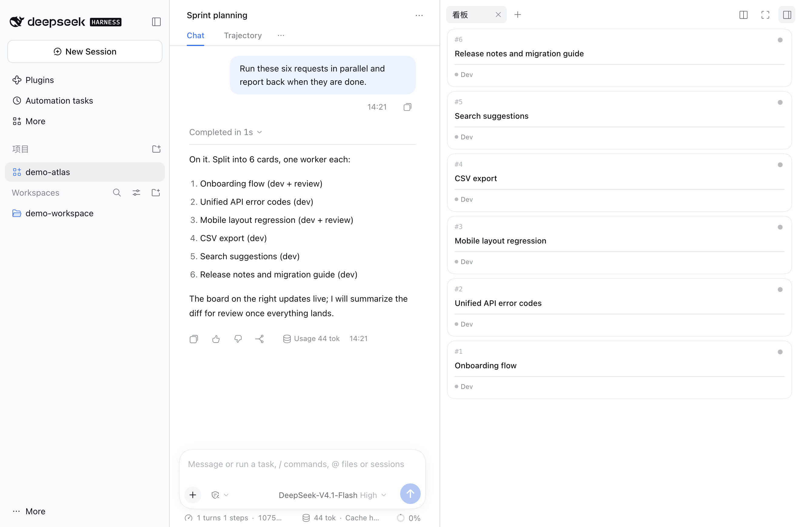

<p align="center">
  <picture>
    <source media="(prefers-color-scheme: dark)" srcset="https://raw.githubusercontent.com/fengshenx/dsh-leader-agent/main/docs/assets/readme/logo-en-dark.svg">
    
  </picture>
</p>

<p align="center">
  <strong>English</strong> | <a href="README_ZH.md">简体中文</a> | <a href="https://fengshenx.github.io/dsh-leader-agent/">Website</a>
</p>

<p align="center">
  <a href="https://www.npmjs.com/package/dsh-leader-agent"></a>
  <a href="https://github.com/fengshenx/dsh-leader-agent/actions/workflows/ci.yml"></a>
  <a href="LICENSE"></a>
  
  
  <a href="https://www.npmjs.com/package/dsh-leader-agent"></a>
  <a href="https://github.com/fengshenx/dsh-leader-agent/stargazers"></a>
</p>

# dsh-leader-agent

> One Leader drives the work and the review, so you can run ten features in parallel instead of babysitting each one.
>
> A leader / worker orchestration bundle for DeepSeek Harness (dsh). The Leader splits work, dispatches it, tracks every worker to completion, checks what comes back and runs review; workers do the work in the background, report back automatically, and every task fact lands on a board organized by project. Running one worktree per task is this repository's convention, not a requirement of the bundle.

## Highlights

1. **One Leader drives development and review** — state the goal once: it opens cards, dispatches workers, watches each one finish, checks the deliverable and organizes review. Target: ten features in flight at once.
2. **A board that shows who is working** — one per project, as a **Work** list or a **Cinematic** workflow map. Cards carry the executor slot and a live status light; click a card for its spec, or a slot to drill into that agent's session and keep talking.
3. **Arrangement lives in two files** — `LEADER.md` holds the Leader's prompt and this project's rules, `SLOTS.md` gives each worker role its own. Edits apply on the next request, with no session rebuild.
4. **Many projects in parallel, one Leader each** — adding a project binds a leader session and lists its workers; deleting it keeps the folder and sessions, and a new Leader inherits the workers plus undelivered reports.
5. **A protocol skill, not a persona line** — `leader-mode` stages the work from discussion through design, delivery, review and merge, with playbooks for parallel collaboration and handoff.
6. **A stall surfaces instead of hanging** — a worker with no report for 15 minutes triggers a background patrol notice (【后台巡查】) carrying its card, last report and a copy-pasteable read-back call; `read_worker_session` then replays what it did, read-only and without waking it.

## Install

### Desktop install (DeepSeek Harness Desktop)

Desktop uses its own profile (`$DSH_HOME/profiles/desktop`), separate from `web`. The **delivery board is a web-profile feature**; the desktop profile loads the plugin without it.

**GUI install:** open **Plugins** in the left sidebar, click **Add plugin** in the top right, type `dsh-leader-agent` and click **Install**:


**CLI install:** the system `dsh` refuses to manage the desktop profile; use the CLI bundled with the desktop install:

```sh
# quit the app completely first (closing the window only hides it)
"/Applications/DeepSeek Harness.app/Contents/Resources/runtime/cli/bin/dsh" \
  plugin --profile desktop add dsh-leader-agent
```

On Windows / Linux, use `runtime/cli/bin/dsh` inside the installation directory. The app reads the profile only at startup, and only one version can be mounted at a time. `DSH_HOME` must be absolute or start with `~/`. Sessions, projects, and cards are shared with `web`; plugin packages and activation are separate.

Development: `npm run desktop` uses an isolated root (`.dev/desktop-home`); `npm run desktop:prod` uses a shadow root (`.dev/desktop-prod-home`) linking sessions/cards to `~/.dsh`; online profile untouched. Both run local code; direct launches use the installed version. `-- --remove` cleans its root; `-- --remove --remove-mount` removes a legacy mount.

### Web install

Install from npm (package name `dsh-leader-agent`):

```sh
dsh plugin --profile web add dsh-leader-agent
dsh web
```

The profile must be named `web`; custom names are absent from `PROFILE_TEMPLATES`, so the install lacks the web-app bundle and the client half never loads. Requires dsh `>=0.2.1-rc.2 <0.3.0`.

For pinning a version, removing it, development installs, or trying it without a profile, see [Development](docs/development.md).

## Preview

<div align="center">
  
</div>

**Work mode (default).** The plain list: one card per task with a slot chip per executor. Left: projects and their workers. Center: the Leader's session — task, dispatch, report, verdict. Right: the board; click an executor to open its session.

<div align="center">
  
</div>

**Cinematic mode.** The same board as a workflow map: cards on a trunk, one branch per executor; only a running branch animates. Built for demos and social sharing. Shown in the dark theme; the light theme uses electric-blue lines.

Switch under **Settings → Leader Agent → Task board**; the choice is stored per instance. Work-mode shot is a real session; cinematic shot is the browser e2e fixture (real host + local mock).

## How it runs

```text
you ──────▶ Leader (the leader session, sole commander of the project)
             │  create_card      record what to build and how it is accepted
             │  spawn_worker     create the worker session, return immediately
             │  message_worker   deliver the first message — that is what starts work
             ▼
      worker ─ worker ─ worker        each runs in its own project directory
             │                        (one worktree each is the project convention, see Prerequisites)
             │  the turn end is settled by the runtime, workers submit nothing
             ▼
      Leader wakes up ──▶ board status lights update ──▶ open any worker and keep talking
```

Three mechanisms make this more than "a smarter prompt":

- **Identity decides the tool surface.** The Leader gets `spawn_worker` / `message_worker`; workers don't. The host trims the tool surface when a session is created — the model is not trusted to hold back.
- **Completion is settled by the runtime, which wakes the Leader.** When a worker's turn ends, the Leader receives a report (rendered as the worker speaking), with no polling from the Leader and no submit step from the worker.
- **Workers are persistent root sessions.** Several run at once, you can open any of them and keep the conversation going, and they cold-resume after a restart. The cost: the Leader cannot stop one, see [Current limitations](#current-limitations).
- **Project sessions get a tab bar.** The project name is the Leader tab; workers you open join it with a live status light. The bar's right end carries the session **More** menu and the right-panel toggle, so the close control stays put. Closing a tab only drops the shortcut — the session stays in the project tree.

## Design trade-offs

- This project does not aim to rebuild [the Super-agent research prototype from the DeepSeek Harness team](https://github.com/deepseek-ai/dsh-superagent-prototype) (a research prototype, not an official DeepSeek product), which watches one repository and runs event-driven sessions. It solves a different problem: letting one person manage 20+ sessions, with a Leader, a board and parallel tasks ([FAQ](https://fengshenx.github.io/dsh-leader-agent/#faq)).
- Today's agents are not reliable enough to run unattended, so the design assumes you can interrupt or push any worker at any point.
- The routing layer runs a full-size model. In practice, holding the global picture, it often connects several PRs in one thought and resolves what a single worker cannot see.
- Agent orchestration generalizes. A card describes the task itself, so it works outside coding and composes with any skill.
- Initialization is still manual: in your own project you write `LEADER.md` (the Leader's persona prompt and orchestration flow) and `SLOTS.md` (the role split and each role's persona prompt).
- The Leader leads and workers never talk to each other; the tool surface rules it out. Today's agents are trained for strict instruction-following, and one noisy message between two agents can derail the entire conversation.

## Quick start

The shortest path is: add a project, load `leader-mode`, dispatch a worker, record the card, then watch the board. The full walkthrough is in [getting started](docs/getting-started.md); each action is documented in the [usage manual](docs/usage.md).

1. **Add a project.** In the left sidebar's Projects section, click Add project and pick a directory. The project is bound to a Leader immediately; the project row is its entry point. Details: [projects](docs/usage.md#加项目) and [getting started](docs/getting-started.md#二加一个项目就得到一个-leader).
2. **Load the protocol.** In the Leader session, load the `leader-mode` skill. It starts with `playbooks/program.md`, then the playbook for the current stage.
3. **Dispatch.** `spawn_worker` creates a worker (optionally with `cardId` + `slot`, `model` / `effort`); `message_worker` sends the first message and starts it. Later messages steer the same worker. The worker inherits the Leader's sandbox and approval policy, and the receipt reports the effective permissions. Use `read_worker_session` to inspect and `list_workers` to inventory. Details: [dispatch](docs/usage.md#派工) and [worker control](docs/limitations.md#worker-的控制面).
4. **Record task facts.** `create_card` / `update_card` / `list_cards` manage cards; content changes carry `expectedRevision`; links are deliverable entry points (not comment anchors) and use `links` / `addLinks`. Workers can only update their bound card's links; `read_card` returns a worker to its task, and long specs page via `specOffset`. Details: [cards](docs/usage.md#卡片).
5. **Watch the board.** The right-panel Board tab shows cards for the current project and opens when the Leader creates one. Click a card for details, or a slot chip to open the executor. Details: [board](docs/usage.md#看板).

`LEADER.md` and `SLOTS.md` are the project manuals; `leader-mode` is the protocol; the target project's `AGENTS.md` remains the host's shared engineering instructions. None grant tool permissions. See [project prompts](docs/usage.md#项目提示词), [getting started](docs/getting-started.md#三两份文件leader-的人设worker-的工作方法), and the `init-leader-agent` skill for setup.

## Prerequisites: multi-worktree isolation

One worktree, one dsh instance and one data root per task; otherwise parallel tasks overwrite each other's plugin version and compete for sessions and data. Details: [development](docs/development.md) and [architecture](docs/architecture.md#协作与文档机制).

## Current limitations

- **Long-lived host required** (web / desktop / sdk): headless is one-shot, so completion reports have nowhere to land.
- **The Leader can steer but cannot cancel a worker**: host subagent tools do not apply; a wedged worker needs a human in its session.
- **Completion reports depend on the turn ending normally**; a killed process leaves that turn unsettled.
- **The board and project tree are project-session-only**; the tab bar is a DOM overlay with per-project state in browser localStorage.
- **Card details only edit links or delete the card**; other card changes stay on the Leader tools.
- **The project registry lives only in the left sidebar**, and project sessions coexist with the official workspace tree.
- **The client is coupled to the host version.**

The full list is in [known limitations](docs/limitations.md) (Chinese).

## Development

```sh
npm run worktree:spawn <task>     # create the worktree and feature branch
cd .worktrees/<task>
npm run dev                       # dsh instance mounting this worktree's plugin
npm run check                     # full gate
npm run e2e                       # browser e2e
```

Data roots, instance overrides, build constraints and the test policy are in [development](docs/development.md) (Chinese); the command index is in [AGENTS.md](AGENTS.md#常用命令) (Chinese). `npm start` runs the daily instance.

## Contributing

Read [AGENTS.md](AGENTS.md) first: worktree discipline, verification requirements, and documentation rules live there. The short path is `npm install` → `npm run check` → open a PR. Commit messages are in Chinese, and non-trivial changes ship an `.agents/notes/` decision note in the same PR.

## Docs

| Document | Contents |
|---|---|
| [AGENTS.md](AGENTS.md) | Repository rules and the task-routed reading index |
| [docs/getting-started.md](docs/getting-started.md) | Walkthrough (Chinese): prerequisites, adding a project and its Leader, the two project files, one card from creation to drill-down |
| [docs/usage.md](docs/usage.md) | Usage manual: projects, dispatch, cards, board, slots and manuals |
| [docs/architecture.md](docs/architecture.md) | Layers, runtime model, data flow, persistence layout, host-contract landing spots |
| [docs/limitations.md](docs/limitations.md) | Known limitations |
| [docs/development.md](docs/development.md) | Dev environment, instances, build contract, test policy |
| [docs/capability-gaps.md](docs/capability-gaps.md) | Measured evidence for host capability boundaries (read before touching host-side code) |
| [docs/e2e-testing.md](docs/e2e-testing.md) | Browser e2e lane (commands, fixtures, mock conventions, screenshots) and manual evidence rules; assertion discipline and failure diagnosis live in `.agents/skills/e2e-scenarios/` |
| [growing/](growing/) | Growth archive: case studies, copy, source files; media lives in OSS |
| [.agents/notes/](.agents/notes/) | Decision memory for non-trivial changes |
| [.agents/skills/leader-mode/](.agents/skills/leader-mode/) | Protocol layer: dispatch, handoff, event scheduling, card upkeep, acceptance |
| [.agents/skills/promo-video/](.agents/skills/promo-video/) | Promo pipeline for the repo dev env (needs Playwright + ffmpeg): storyboard, TTS timeline, capture/record, cover production; narration in `doubao-tts/`, covers in `promo-stills/` |

## Credits

The design drew on **Cursor's Project implementation** and **PStack's orchestration mechanism**: treating a project as a first-class entity, aggregating sessions and deliverables per project, and the leader-dispatches / executor-reports / delivery-board line.

The session tab bar drew on [dsh-session-tabs](https://github.com/QIN-SMART/dsh-session-tabs) (MIT) for main-panel anchoring and per-project tab persistence; see [THIRD_PARTY_LICENSE](THIRD_PARTY_LICENSE) for the full third-party inventory.

Thanks also to the **DeepSeek Harness team**: the host plugin contract, and the worktree, Agent Note, progressive-disclosure and documentation practices this repository mirrors directly.

## License

[MIT](LICENSE)

Third-party notices: [THIRD_PARTY_LICENSE](THIRD_PARTY_LICENSE).
