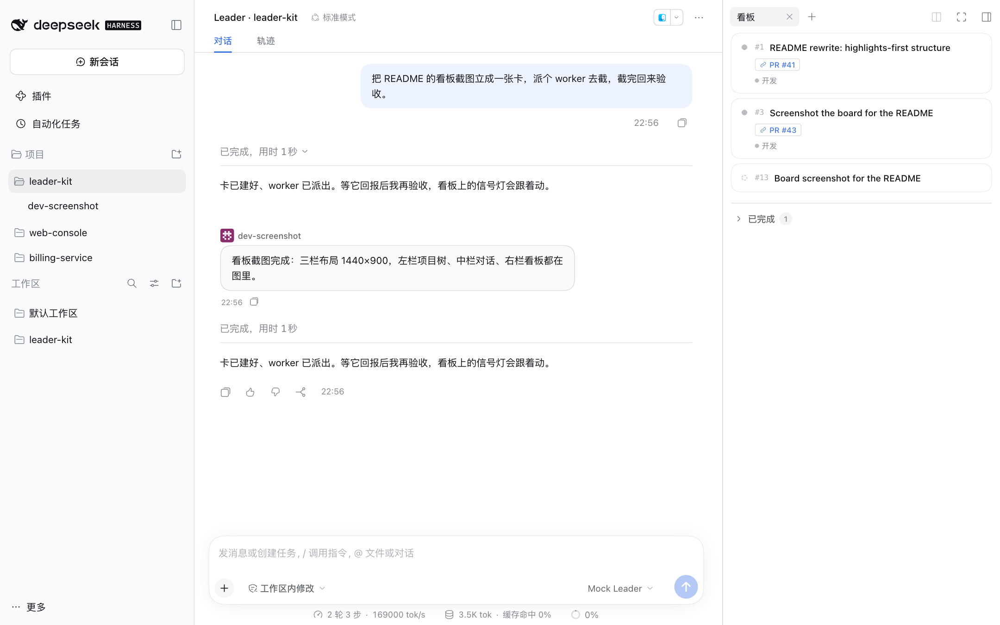

<p align="center">
  <picture>
    <source media="(prefers-color-scheme: dark)" srcset="docs/assets/readme/logo-zh-dark.svg">
    
  </picture>
</p>

<p align="center">
  <a href="README.md">English</a> | <strong>简体中文</strong>
</p>

<p align="center">
  <a href="https://www.npmjs.com/package/dsh-leader-kit"></a>
  <a href="https://github.com/fengshenx/dsh-leader-kit/actions/workflows/ci.yml"></a>
  <a href="LICENSE"></a>
  
  
  <a href="https://www.npmjs.com/package/dsh-leader-kit"></a>
  <a href="https://github.com/fengshenx/dsh-leader-kit/stargazers"></a>
</p>

# dsh-leader-kit

> 一个 Leader 帮你推进开发和 Review，解放你的注意力：同时并行开发 10 个 feature，而不是逐个陪跑。
>
> DeepSeek Harness（dsh）的 leader / 执行者编排 bundle。Leader 拆解、派工、盯完成、收产物、组织审查；worker 在后台各自干活、完成自动回报，任务事实落进按项目组织的看板。一人一个 worktree 是本仓的约定，不是 bundle 的硬性要求。

## 亮点

1. **通过一个 Leader，帮你推进开发和 Review** — 你只跟 Leader 说目标，它拆卡、派工、盯住每个 worker 的完成、验证产物、组织审查。注意力回到「要什么」上，不用逐个陪跑——目标规模是一次并行开发 10 个 feature。
2. **右栏 SidePanel 看板，正在工作的 Agent 一目了然** — 一个项目一块看板。卡面上是执行者槽位与实时信号灯，卡片说明按 Markdown 渲染，链接可在浮层里直接编辑；点卡面看详情（目标、范围、验收、链接，其余只读），点槽位直接下钻进那个 Agent 的会话接着聊。worker 的回报也渲染成气泡，同样支持 Markdown。
3. **Agent 自由编排** — 拆成两份文件：`LEADER.md` 写 Leader 的 prompt 与项目编排规则（职责边界、派工要求、验收口径）；`SLOTS.md` 按角色给 worker 写编排规则（讨论 / 开发 / 审核……）。两者在每次模型请求前求值、正文变化才追加，改文件即改行为，不用重建会话。
4. **多项目并行，每个项目一个 Leader** — 左栏加一个项目就绑定一个 leader 会话，项目树列出它派出的 worker；项目行可拖拽排序，删除项目会一并摘掉插件注册的工作区、保留文件夹与会话记录。项目之间各管各的。换 Leader 时原班 worker 与未投递的回报一并改投新会话，新 Leader 直接接着派。
5. **`leader-mode` skill，给 Leader 的编排 Skill** — 不是一句「你是 tech lead」：按技术讨论 → 设计 → 实现交付 → 审查 → 合入分阶段给 playbook，另有并行协作与交接规范。
6. **回看 worker 的会话过程，不必唤醒它** — `read_worker_session` 直读 worker 的会话日志，给出每轮的任务、正文、调过哪些工具与失败原因。只读：不唤醒 worker、不产生模型调用。完成通知负责「产物是什么」，它负责「过程是怎样的」，排查不必再开一轮。

## 预览

<div align="center">
  
</div>

左边是项目与每个 Leader 派出的 worker；中间是 Leader 的会话——任务、派工、worker 回报、验收；右边是这个项目的交付看板，一卡一件事，槽位 chip 标出执行者。你能看到正在工作的 Agent，点击即可下钻到它的会话，绕开 Leader 直接和它对话。

截图取自真实工作会话。

## 它是怎么跑起来的

```text
你 ──────▶ Leader（leader 会话，项目的唯一指挥）
             │  create_card     记下要做什么、验收是什么
             │  spawn_worker    建 worker 会话，立即返回
             │  message_worker  投第一条消息——开工的是它
             ▼
      worker ─ worker ─ worker        各自在自己的项目目录里后台并行
             │                        （一人一个 worktree 是项目约定，见「前提」）
             │  turn 结束由机制侧结算（worker 不用调工具交作业）
             ▼
      Leader 被唤醒 ──▶ 看板信号灯更新 ──▶ 你打开任一 worker 接着聊
```

三条机制决定了它不是「一个更聪明的 prompt」：

- **身份决定工具面**：Leader 拿得到 `spawn_worker` / `message_worker`，worker 拿不到；工具面在会话创建时由宿主裁剪，不是靠提示词约束模型。
- **完成由机制结算并自动唤醒**：worker 那一轮结束时，Leader 自动收到一条回报（渲染成 worker 的发言气泡），不轮询、不靠 worker 自觉。
- **worker 是常驻根会话**：能同时跑多个，人可以直接打开它的会话接着聊，进程重启后能冷恢复。代价是 Leader 侧不能强杀它，见[当前限制](#当前限制)。

## 设计取舍

- 这个项目不想复刻 dsh 的 super agent，只是想解决现有的问题（让 1 个人可以管理 20 个以上的 Session）。
- 在当前 agent 还不是那么完善的情况下，这个项目的思路是你可以随时打断或者推进某个 worker 的工作。
- routing 层用的是完整大模型，实际使用中，routing 层由于知道全局信息，经常能够把多个 PR 串起来思考，解决单 Worker 看不到的问题。
- Agent 编排的泛化。Card 是任务本身的描述，可以用在非编码场景，也可以和各种 Skill 集成。
- 项目还缺少一些初始化机制，实际使用时你需要在你的项目内初始化 `LEADER.md`（Leader 的人设 Prompt 以及编排流）和 `SLOTS.md`（任务的角色分工以及对应的人设 Prompt）。
- 项目设计成了 Leader 领导 Worker，Worker 之间绝不通信（Tool Use 层就杜绝了），因为当前的 Agent 被训练成了强指令遵循，两个 Agent 对话一旦出现一个错误的噪音，会把整个对话带偏。

## 快速开始

### 安装

从 npm 安装（包名 `dsh-leader-kit`）：

```sh
dsh plugin --profile web add dsh-leader-kit
dsh web
```

profile 名必须用 `web`；自定义名不在 `PROFILE_TEMPLATES` 里，装出来缺 web-app bundle，客户端半边不加载。需要 dsh `>=0.2.1-rc.2 <0.3.0`。

指定版本、卸载、开发期安装与不装 profile 直接试跑见[开发](docs/development.md)。

profile 名必须用 `web`：插件 manifest 声明 `platform: web`，而 `dev` 这类自定义名字不在 dsh 的 `PROFILE_TEMPLATES` 里，`dsh plugin` 会按默认模板只装 `@deepseek-ai/dsh-base`——没有 web-app bundle，插件客户端半边根本不加载。

`engines.dsh` 声明支持范围（当前 `>=0.2.1-rc.2 <0.3.0`），不满足时安装与启动会被拒绝；dsh 处于 developer preview，版本范围需随它跟进。在本仓库里可以直接 `npm start`：它先构建 `lib/client.js`（不入库，漏构建时实例照常起来、右栏却没有看板），再起 `dsh web`，起之前检查 dsh 是否可用、日常 profile 是否装了本插件。

### 桌面版（DeepSeek Harness Desktop）

桌面版用独立 profile（`$DSH_HOME/profiles/desktop`），与上面的 `web` 互不相通。系统 `dsh` 拒绝管理它，要用桌面安装自带的 CLI：

```sh
# 先完全退出应用（关窗口只是隐藏）
"/Applications/DeepSeek Harness.app/Contents/Resources/runtime/cli/bin/dsh" \
  plugin --profile desktop add dsh-leader-kit
```

Windows / Linux 换成安装目录里对应的 `runtime/cli/bin/dsh`。也可以在应用的插件管理里「添加插件」，填包名或本仓库绝对路径。

应用只在启动时读 profile，同一时刻只能挂一个版本；`DSH_HOME` 要用绝对路径或 `~/` 写法。会话、项目与卡片数据与 `web` 共享，插件包与激活状态各自一份。

在本仓库里开发时改用 `npm run desktop`：挂当前工作树、重建产物并拉起应用，`-- --remove` 摘除。

### 五步上手

1. **加项目**：左栏「项目」区块点「加项目」，选一个目录。项目当场建好并绑定一个 leader 会话；点项目行就是打开这个 Leader（注册的工作区被删过的话会顺手重建并归位会话）。当前会话属于该项目时左栏按两层回执：打开的是 leader 会话则项目行整行亮，打开的是它派出的 worker 则项目行只点亮行首文件夹、选中态落在那个 worker 自己的会话行上。行首槽位平时是目录图标，活动提示看 leader：它在跑就换成加载圈（leader 没有自己的行，项目展开着也照换），项目收起时名下有 worker 在跑也换成加载圈，展开后 worker 由会话行自己带加载圈。
2. **加载协议**：leader 会话里让模型加载 `leader-mode`，先读 `playbooks/program.md`，再按阶段读对应 playbook。
3. **派工**：`spawn_worker` 只要求 `name`（角色-任务短名），可带 `cardId` + `slot` 一次把卡槽位绑好；工具立即返回会话 id，此时 worker **还没开工**。用 `message_worker` 投递任务正文（`sessionId` + `message`，可顺手 `rename`），第一条消息才开工；挂卡 worker 的请求会自动带上卡片事实，消息里不必抄 spec。worker 的沙箱模式与审批策略在派工那一刻从 leader 继承（leader 是 Auto 时连审查门一起继承），回执里写明它实际以什么权限在跑，完全权限会被点名。要看它这一轮怎么做的（调了哪些工具、哪步失败），用 `read_worker_session` 回看，不必唤醒它。
4. **记任务事实**：`create_card` 建卡（`title` 必填），`update_card` 改卡（改内容带 `expectedRevision` 做乐观并发；链接可用 `links` 整体替换，或用 `addLinks` 按 id 增量追加），`list_cards` 查卡。卡片按项目归属、编号全局递增，跨项目改卡会被拒绝。`list_cards` 与 `create_card` 只给 leader，普通会话一件也没有；`update_card` leader 与 worker 都有。worker 只能改自己挂着的卡，且只能挂 `links` 这类派生字段：`title` / `spec` / `status` / `slots` 都归 leader（前两者是验收锚点与注入内容，后两者决定谁在执行、卡是否算完成）。
5. **看看板**：右栏「看板」Tab，按当前会话所属项目拉卡片。leader 建卡后自动打开；点卡面看详情（链接可编辑，其余只读），点槽位 chip 打开执行者会话。

## 编排：把规则写进文件

三份东西各管一层，都只贡献提示词，不授予工具权限：

| 文件 / skill | 写给谁 | 管什么 |
|---|---|---|
| `LEADER.md` | 项目里的 Leader | 这个项目怎么指挥：职责边界、卡与派工的粒度、必须写进简报的硬约束、验收口径。leader 会话自动注入，不需要绑定 |
| `SLOTS.md` | 不同角色的 worker | 按 `## <槽位名>` 分节写角色方法与人设（`discuss` / `dev` / `review`…）；卡片 `slots` 字段把槽位绑到会话，被绑会话注入对应分节 |
| `leader-mode` skill | Leader 的编排协议 | 技术讨论 → 设计 → 实现交付 → 审查 → 合入的分阶段 playbook，加并行协作与交接规范 |

`LEADER.md` 与 `SLOTS.md` 在每次模型请求前求值、正文变化才追加：改动在下一个请求生效，没变的轮次不重复注入。`leader-mode` skill 走的是另一条路——模型按需调 `skill` 工具加载，所以上面第 2 步写的是「加载」而不是「配置」。目标项目自己的 `AGENTS.md` 由宿主的 agent-instructions 读成系统提示段落。卡片转为 `done` / `archived` 即释放执行者——槽位绑定与卡片事实一起停止注入。

插件只读 `LEADER.md`。项目里另放一个只指向它的 `COORDINATOR.md` 是给 Telov 等仍按旧文件名找 leader 手册的外部工具用的兼容入口，不参与注入；没有那个工具就不需要建。

槽位名是 ASCII 标识（小写字母、数字、下划线、连字符，最长 32 字符），界面显示名由 `SLOTS.md` 顶部 frontmatter 的 `slots:` 声明。没写 `SLOTS.md` 的项目回落默认三角色 `discuss` / `dev` / `review`。

`init-project` skill 做另一件事：把仓库工程约定（worktree 纪律、验证要求、文档机制）并入目标项目 `AGENTS.md` 的受管区块，写入即对后续会话生效，重复执行只替换受管区块，不覆盖项目自己的内容。

完整交互（槽位 frontmatter 细节、归档、换 leader、看板信号灯口径）见[使用手册](docs/usage.md)。

## 前提：先跑通多 worktree 并发

并行 10 个 feature 的前提是任务隔离：每个任务一个 worktree、一个独立 dsh 实例、一份独立数据根，互不覆盖插件版本、不抢会话与数据。本仓的 `scripts/worktree-*.mjs` 与 `scripts/dev.mjs` 就是为这件事准备的（见[开发](docs/development.md)），机制与落点见[架构文档的协作与文档机制](docs/architecture.md#协作与文档机制)。

## 当前限制

- **后台编排只适用于长驻组合**（web / desktop / sdk）。headless 是一次性 CLI，会话在 turn 结束后即销毁，没有载体接收完成通知。
- **Leader 不能中止 worker**：worker 是普通根会话，宿主的 `list_agents` / `send_message` / `interrupt_agent` 对它无效（`interrupt_agent` 会返回假成功）。跑偏了只能请人去那个会话处理——这是常驻化换来的代价。能读它的会话过程（`read_worker_session`，只读、不唤醒），但不能替它动手或叫停。
- **完成回报依赖轮次正常结束**：进程在 worker 跑完前被杀，那一轮不结算；重启后自己打开 worker 会话看或续聊。
- **看板只对项目会话展示**：leader 与该项目的 worker 能看到；同目录的普通会话与已换下的 leader 只看到提示，不属于任何项目的会话也没有看板。
- **卡片详情只写链接**：链接可在详情里增删改，其余操作（完成、置顶、重命名、删除）仍归 leader 的卡片工具；编号全局递增，跨项目不复用、不回收。
- **项目注册表只经左栏区块操作**：模型没有项目工具；目录选择器不可用时无法建项目，需换 web profile。
- **项目树与官方工作区树并存**：项目会话从官方树里的隐藏是渲染层排除，官方计数与搜索仍包含它们；项目目录本身也作为一行工作区显示在官方树里，两处都能进。
- **客户端与宿主版本耦合**：弹窗、菜单、图标复制自宿主源码，Typert 远程通道是手写协议形状，leader 会话形态依赖宿主的会话视图服务——宿主升级时要同步本仓。

完整清单与取舍（信号灯数据源、水位折叠、头像、归档入口、DOM 注入取位等）见[已知限制与取舍](docs/limitations.md)。

## 开发

```sh
npm run worktree:spawn <任务名>   # 建 worktree + feature 分支
cd .worktrees/<任务名>
npm run dev                       # 起挂当前工作树的 dsh 实例
npm run check                     # 全量门禁
npm run e2e                       # 浏览器 e2e
```

数据根、实例覆盖项、构建契约与测试口径见[开发](docs/development.md)；常用命令见 [AGENTS.md](AGENTS.md#常用命令)。`npm start` 起日常实例。

## 贡献

改代码前先读 [AGENTS.md](AGENTS.md)：worktree 纪律、验证要求与文档机制都在那里。最短路径是 `npm install` → `npm run check` → 开 PR；提交信息用中文，非平凡改动同 PR 带 `.agents/notes/` 决策笔记。

## 文档

| 文档 | 内容 |
|---|---|
| [AGENTS.md](AGENTS.md) | 仓库铁律与按任务查阅入口 |
| [docs/getting-started.md](docs/getting-started.md) | 上手路线：使用前提、加项目与 Leader、两份项目文件、一张卡从创建到下钻 |
| [docs/usage.md](docs/usage.md) | 派工、续聊、卡片、看板、项目管理、槽位与手册的完整交互 |
| [docs/architecture.md](docs/architecture.md) | 分层、运行时模型、数据流、持久化布局、宿主契约落点 |
| [docs/limitations.md](docs/limitations.md) | 完整已知限制与取舍 |
| [docs/development.md](docs/development.md) | 开发环境、实例、构建契约与测试口径 |
| [docs/capability-gaps.md](docs/capability-gaps.md) | 宿主能力边界的实测依据（改宿主侧前先读） |
| [docs/e2e-testing.md](docs/e2e-testing.md) | 浏览器 e2e 车道（命令、夹具、mock 约定、断言纪律）与人工取证规范 |
| [.agents/notes/](.agents/notes/) | 非平凡改动的决策记忆 |
| [.agents/skills/leader-mode/](.agents/skills/leader-mode/) | 协议层：派工、接力、事件调度、卡片维护、验收裁决 |

## 致谢

本方案在设计时参考过 **Cursor 的 Project 实现**与 **PStack 的编排机制**：把项目当成一等实体、按项目聚合会话与交付物，以及「leader 派工 / 执行者回报 / 交付看板」这条主线。

也感谢 **DeepSeek Harness 团队**：宿主的插件契约，以及 worktree 并发、Agent Note、AGENTS.md 渐进式披露、文档防腐化这套工程实践，是本仓直接对照的来源。

## 许可证

[MIT](LICENSE)
