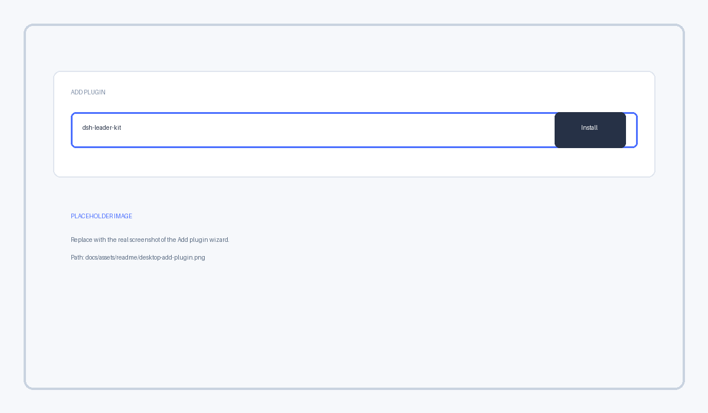
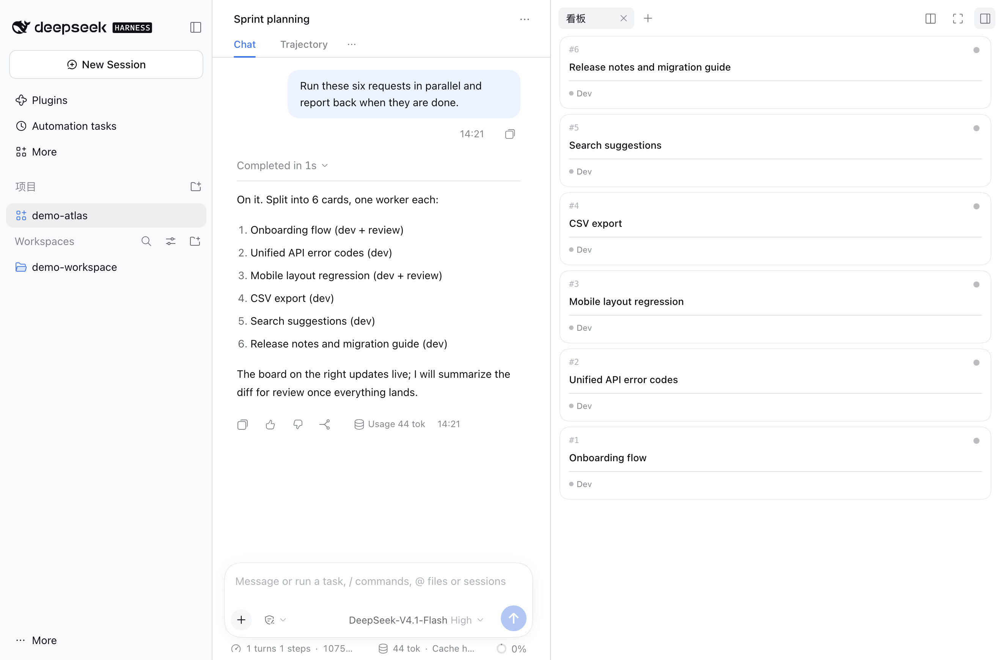
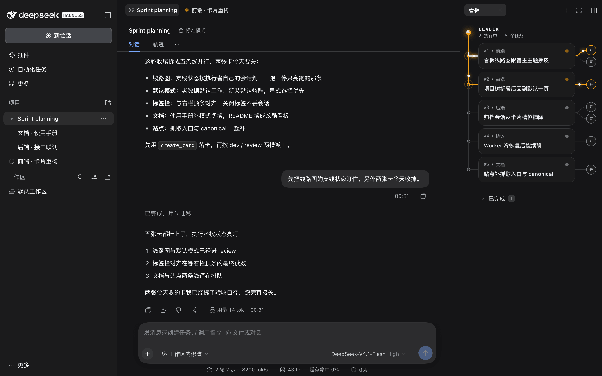

<p align="center">
  <picture>
    <source media="(prefers-color-scheme: dark)" srcset="https://raw.githubusercontent.com/fengshenx/dsh-leader-agent/main/docs/assets/readme/logo-zh-dark.svg">
    
  </picture>
</p>

<p align="center">
  <a href="README.md">English</a> | <strong>简体中文</strong> | <a href="https://fengshenx.github.io/dsh-leader-agent/">官网</a>
</p>

<p align="center">
  <a href="https://www.npmjs.com/package/dsh-leader-agent"></a>
  <a href="https://github.com/fengshenx/dsh-leader-agent/actions/workflows/ci.yml"></a>
  <a href="LICENSE"></a>
  
  
  <a href="https://www.npmjs.com/package/dsh-leader-agent"></a>
  <a href="https://github.com/fengshenx/dsh-leader-agent/stargazers"></a>
</p>

# dsh-leader-agent

> 一个 Leader 帮你推进开发和 Review，解放你的注意力：同时并行开发 10 个 feature，而不是逐个陪跑。
>
> DeepSeek Harness（dsh）的 leader / 执行者编排 bundle。Leader 拆解、派工、盯完成、收产物、组织审查；worker 在后台各自干活、完成自动回报，任务事实落进按项目组织的看板。一人一个 worktree 是本仓的约定，不是 bundle 的硬性要求。

## 亮点

1. **通过一个 Leader，帮你推进开发和 Review** — 你只说一次目标：它拆卡、派工、盯住每个 worker 的完成、验证产物、组织审查。目标规模是一次并行开发 10 个 feature。
2. **一块看得见谁在干活的看板** — 一个项目一块，**工作**列表或**炫酷**线路图两种呈现；卡面是执行者槽位与实时信号灯，点卡看详情，点槽位直接钻进那个 Agent 的会话接着聊。
3. **编排规则写进两份文件** — `LEADER.md` 写 Leader 的 prompt 与本项目的编排规则，`SLOTS.md` 按角色给 worker 写。改文件即改行为，下一次请求生效，不用重建会话。
4. **多项目并行，每个项目一个 Leader** — 加项目即绑定一个 leader 会话并列出它派出的 worker；删项目只删记录、保留文件夹与会话；换 Leader 时原班 worker 与未投递的回报一并改投。
5. **给 Leader 的编排 Skill，不是一句人设** — `leader-mode` 按讨论 → 设计 → 实现交付 → 审查 → 合入分阶段给 playbook，另有并行协作与交接规范。
6. **卡住的任务会浮出来，不会无限等** — worker 超过 15 分钟没有回报时，会触发一条带「【后台巡查】」前缀的提醒，附挂着的卡、最后回报与可照抄的回看调用；`read_worker_session` 只读回放它做过什么，不唤醒 worker。

## 安装

### 桌面版安装（DeepSeek Harness Desktop）

桌面版用独立 profile（`$DSH_HOME/profiles/desktop`），与上面的 `web` 互不相通。**交付看板是 `web` profile 的功能**，桌面版装的是插件本体，没有看板。

**图形界面安装**：左侧 SidePanel 打开「插件」，点右上角「添加插件」，在包名框填 `dsh-leader-agent` 后点「安装」：



**命令行安装**：系统 `dsh` 拒绝管理 desktop profile，要用桌面安装自带的 CLI：

```sh
# 先完全退出应用（关窗口只是隐藏）
"/Applications/DeepSeek Harness.app/Contents/Resources/runtime/cli/bin/dsh" \
  plugin --profile desktop add dsh-leader-agent
```

Windows / Linux 换成安装目录里对应的 `runtime/cli/bin/dsh`。应用只在启动时读 profile，同一时刻只能挂一个版本；`DSH_HOME` 要用绝对路径或 `~/` 写法。会话、项目与卡片数据与 `web` 共享，插件包与激活状态各自一份。

`npm run desktop` 用 dev 根 `.dev/desktop-home`；`npm run desktop:prod` 用正式数据（影子根 `.dev/desktop-prod-home`，共用日常，线上 profile 不动）。都用本仓代码，直接启动仍用线上；`-- --remove` 清根，旧版用 `-- --remove --remove-mount` 摘。

### Web 版安装

从 npm 安装（包名 `dsh-leader-agent`）：

```sh
dsh plugin --profile web add dsh-leader-agent
dsh web
```

profile 名必须用 `web`；自定义名不在 `PROFILE_TEMPLATES` 里，装出来缺 web-app bundle，客户端半边不加载。需要 dsh `>=0.2.1-rc.2 <0.3.0`。

指定版本、卸载、开发期安装与不装 profile 直接试跑见[开发](docs/development.md)。

## 预览

<div align="center">
  
</div>

**工作模式（默认）**：纯列表，一卡一件事，槽位 chip 标出执行者。左栏项目树、中栏 Leader 会话、右栏看板；点执行者即可下钻到它的会话。

<div align="center">
  
</div>

**炫酷模式**：同一块看板画成线路图——卡片挂主干，执行者是右侧支线，只有执行中的支线跑光点。纯演示，社交媒体传播用。图为深色主题；浅色宿主下是电蓝正交线条。

在 **设置 → Leader Agent → 任务看板** 切换，选择只存本实例；工作模式截图取自真实会话，炫酷模式取自 e2e 夹具（真实宿主 + 本地 mock）。

## 它是怎么跑起来的

```text
你 ──────▶ Leader（leader 会话，项目的唯一指挥）
             │  create_card     记下要做什么、验收是什么
             │  spawn_worker    建 worker 会话，立即返回
             │  message_worker  投第一条消息——开工的是它
             ▼
      worker ─ worker ─ worker        各自在自己的项目目录里后台并行
             │                        （一人一个 worktree 是项目约定，见「前提」）
             │  turn 结束由机制侧结算（worker 不用调工具交作业）
             ▼
      Leader 被唤醒 ──▶ 看板信号灯更新 ──▶ 你打开任一 worker 接着聊
```

三条机制决定了它不是「一个更聪明的 prompt」：

- **身份决定工具面**：Leader 拿得到 `spawn_worker` / `message_worker`，worker 拿不到；工具面在会话创建时由宿主裁剪，不是靠提示词约束模型。
- **完成由机制结算并自动唤醒**：worker 那一轮结束时，Leader 自动收到一条回报（渲染成 worker 的发言气泡），不轮询、不靠 worker 自觉。
- **worker 是常驻根会话**：能同时跑多个，人可以直接打开它的会话接着聊，进程重启后能冷恢复。代价是 Leader 侧不能强杀它，见[当前限制](#当前限制)。
- **项目会话有标签栏**：第一个标签是项目名（Leader 入口），点开的 worker 带着状态灯加入；栏右端是会话「更多」与右栏开关。关标签只丢快捷方式，会话仍在项目树里。

## 设计取舍

- 这个项目不复刻 [DeepSeek Harness 团队的 Super-agent 研究原型](https://github.com/deepseek-ai/dsh-superagent-prototype)（研究原型，不是 DeepSeek 官方产品；它盯一个仓库、按事件起会话），要解决的是另一件事：让 1 个人管理 20 个以上的 Session，有 Leader、看板和并行任务（[项目落地页 FAQ](https://fengshenx.github.io/dsh-leader-agent/#faq)）。
- 在当前 agent 还不是那么完善的情况下，这个项目的思路是你可以随时打断或者推进某个 worker 的工作。
- routing 层用的是完整大模型，实际使用中，routing 层由于知道全局信息，经常能够把多个 PR 串起来思考，解决单 Worker 看不到的问题。
- Agent 编排的泛化。Card 是任务本身的描述，可以用在非编码场景，也可以和各种 Skill 集成。
- 项目还缺少一些初始化机制，实际使用时你需要在你的项目内初始化 `LEADER.md`（Leader 的人设 Prompt 以及编排流）和 `SLOTS.md`（任务的角色分工以及对应的人设 Prompt）。
- 项目设计成了 Leader 领导 Worker，Worker 之间绝不通信（Tool Use 层就杜绝了），因为当前的 Agent 被训练成了强指令遵循，两个 Agent 对话一旦出现一个错误的噪音，会把整个对话带偏。

## 五步上手

1. **加项目**：左栏「项目」区块点「加项目」，选一个目录。项目当场建好并绑定一个 leader 会话；点项目行就是打开这个 Leader。当前会话属于该项目时左栏按两层回执：打开的是 leader 会话则项目行整行亮，打开的是它派出的 worker 则项目行只点亮行首应用格子、选中态落在那个 worker 自己的会话行上。行首槽位平时是应用格子图标（宿主 `apps-add-outline`：三格 + 加号；替掉目录图标，免得「项目」和「工作区」同形），活动提示看 leader：它在跑换成加载圈（leader 没有自己的行，展开与否都换）；项目收起时名下有 worker 在跑也换，展开后由 worker 会话行自己带。
2. **加载协议**：leader 会话里让模型加载 `leader-mode`，先读 `playbooks/program.md`，再按阶段读对应 playbook。
3. **派工**：`spawn_worker` 只要求 `name`（角色-任务短名），可带 `cardId` + `slot` 一次绑好卡槽位，也可带 `model` / `effort`；默认取绑定槽位的 `SLOTS.md`，再回落 leader 模型。工具立即返回会话 id，此时 worker **还没开工**。用 `message_worker` 投递任务正文（`sessionId` + `message`，可顺手 `rename`；`model` / `effort` 可换 route），第一条消息才开工；挂卡 worker 的请求会自动带上卡片事实，消息里不必抄 spec。worker 的沙箱与审批在派工那一刻从 leader 继承（Auto 连审查门一起继承），回执写明实际权限，完全权限会被点名。用 `read_worker_session` 回看它这一轮调了哪些工具、哪步失败，不必唤醒它。
4. **记任务事实**：`create_card` 建卡（`title` 必填），`update_card` 改卡（改内容带 `expectedRevision` 做乐观并发；链接可用 `links` 整体替换，或用 `addLinks` 按 id 增量追加），`list_cards` 查卡。链接只挂 PR / Issue / 文档 / 成片这类交付物入口，不挂评论或行内评论的锚点（`#issuecomment-` / `#discussion_r` / `#pullrequestreview-`）；评论是过程证据，写进回报正文。卡片按项目归属、编号全局递增，跨项目改卡会被拒绝。`list_cards` 与 `create_card` 只给 leader，普通会话一件也没有；`update_card` leader 与 worker 都有。worker 只能改自己挂着的卡，且只能挂 `links` 这类派生字段：`title` / `spec` / `status` / `kind` / `sortOrder` / `slots` 都归 leader（前两者是验收锚点与注入内容，其余组织看板并决定谁在执行）。`read_card` 只给 worker：读本项目的任意卡，不传 `cardId` / `number` 时读自己唯一绑定的卡——压缩或注入失效后找回任务的入口；长规格按 2000 字符分页，用 `specOffset` 续读。
5. **看看板**：右栏「看板」Tab，按当前会话所属项目拉卡片。leader 建卡后自动打开；点卡面看详情（链接可编辑、可删卡，其余只读），点槽位 chip 打开执行者会话。工作模式是默认；想切炫酷，在 `设置 → Leader Agent → 任务看板` 选「炫酷模式」。

## 编排：把规则写进文件

三份不授权工具；手册贡献提示词，槽位可声明默认模型：

| 文件 / skill | 写给谁 | 管什么 |
|---|---|---|
| `LEADER.md` | 项目里的 Leader | 这个项目怎么指挥：职责边界、卡与派工的粒度、必须写进简报的硬约束、验收口径。leader 会话自动注入，不需要绑定 |
| `SLOTS.md` | 不同角色的 worker | 按 `## <槽位名>` 分节写角色方法与人设（`dev` / `review`…）；卡片 `slots` 字段把槽位绑到会话，被绑会话注入对应分节 |
| `leader-mode` skill | Leader 的编排协议 | 技术讨论 → 设计 → 实现交付 → 审查 → 合入的分阶段 playbook，加并行协作与交接规范 |

`LEADER.md` 与 `SLOTS.md` 在每次模型请求前求值、正文变化才追加：改动在下一个请求生效，没变的轮次不重复注入。`leader-mode` skill 走的是另一条路——模型按需调 `skill` 工具加载，所以上面第 2 步写的是「加载」而不是「配置」。目标项目自己的 `AGENTS.md` 由宿主的 agent-instructions 读成系统提示段落。卡片转为 `done` / `archived` 即释放执行者——槽位绑定与卡片事实一起停止注入。

插件只读 `LEADER.md`。项目里另放一个只指向它的 `COORDINATOR.md` 是给仍按旧文件名找 leader 手册的外部工具用的兼容入口，不参与注入；没有那个工具就不需要建。

槽位名是 ASCII 标识（小写字母、数字、下划线、连字符，最长 32 字符），界面显示名由 `SLOTS.md` 顶部 frontmatter 的 `slots:` 声明。没写 `SLOTS.md` 的项目回落默认两角色 `dev` / `review`。槽位可声明默认 `model` / `effort`；没给就回落到 Leader 模型。`message_worker` 可换 route；复用承接该槽位时自动应用默认，同卡续聊不重置。

`init-leader-agent` skill 管项目初始化：先把仓库工程约定并入目标项目 `AGENTS.md` 的受管区块，再按包内骨架写 `LEADER.md`（leader 怎么指挥这个项目）与 `SLOTS.md`（执行者角色）。重复执行只替换受管区块，两份手册先读后改；空目录写带 TODO 的骨架，并把还没答的三个问题问清楚，不编造项目事实。

日常操作（项目、派工、卡片、看板、槽位与手册）见[使用手册](docs/usage.md)。

## 前提：先跑通多 worktree 并发

并行 10 个 feature 的前提是任务隔离：每个任务一个 worktree、一个独立 dsh 实例、一份独立数据根，互不覆盖插件版本、不抢会话与数据。本仓的 `scripts/worktree-*.mjs` 与 `scripts/dev.mjs` 就是为这件事准备的（见[开发](docs/development.md)），机制与落点见[架构文档的协作与文档机制](docs/architecture.md#协作与文档机制)。

## 当前限制

- **后台编排只适用于长驻组合**（web / desktop / sdk）。headless 是一次性 CLI，会话在 turn 结束后即销毁，没有载体接收完成通知。
- **Leader 能纠偏、但不能中止 worker**：worker 是普通根会话，宿主的 `list_agents` / `send_message` / `interrupt_agent` / `wait_agent` 对它无效（`interrupt_agent` 会返回假成功，`wait_agent` 只会阻塞空等）。跑偏了用 `message_worker` 把纠偏指令 steer 进它当前轮次（正在跑就插下一步）；没有中止手段——宿主的 `Agent.cancel()` 没被接成工具，真卡死只能请人去那个会话处理。能读它的会话过程（`read_worker_session`，只读、不唤醒）。
- **完成回报依赖轮次正常结束**：进程在 worker 跑完前被杀，那一轮不结算；重启后自己打开 worker 会话看或续聊。
- **看板只对项目会话展示**：leader 与该项目的 worker 能看到；同目录的普通会话与已换下的 leader 只看到提示，不属于任何项目的会话也没有看板。
- **会话标签栏是 DOM 注入，不是宿主原生能力**：它插在会话头之上，标签状态按项目存在浏览器 localStorage，不随数据根迁移。
- **卡片详情的人工写操作只有链接与删除**：链接可在详情里增删改；删除在详情页脚，二次确认后硬删、不可撤销，编号不复用，槽位绑定一并解除；完成、置顶、重命名仍归 leader 的卡片工具。模型没有删除卡片的工具，删除只能由人点出来。
- **项目注册表只经左栏区块操作**：模型没有项目工具；目录选择器不可用时无法建项目，需换 web profile。
- **项目树与官方工作区树并存**：项目不注册也不占用 dsh 工作区，项目会话落进官方树的「未分组」，在那里被渲染层排除（官方计数与搜索仍包含它们）；组里只剩被排除的行时「未分组」组头一起藏起来。
- **客户端与宿主版本耦合**：弹窗、菜单、图标复制自宿主源码，Typert 远程通道是手写协议形状，leader 会话形态依赖宿主的会话视图服务——宿主升级时要同步本仓。

完整限制清单见[已知限制](docs/limitations.md)。

## 开发

```sh
npm run worktree:spawn <任务名>   # 建 worktree + feature 分支
cd .worktrees/<任务名>
npm run dev                       # 起挂当前工作树的 dsh 实例
npm run check                     # 全量门禁
npm run e2e                       # 浏览器 e2e
```

数据根、实例覆盖项、构建契约与测试口径见[开发](docs/development.md)；常用命令见 [AGENTS.md](AGENTS.md#常用命令)。`npm start` 起日常实例。

## 贡献

改代码前先读 [AGENTS.md](AGENTS.md)：worktree 纪律、验证要求与文档机制都在那里。最短路径是 `npm install` → `npm run check` → 开 PR；提交信息用中文，非平凡改动同 PR 带 `.agents/notes/` 决策笔记。

## 文档

| 文档 | 内容 |
|---|---|
| [AGENTS.md](AGENTS.md) | 仓库铁律与按任务查阅入口 |
| [docs/getting-started.md](docs/getting-started.md) | 上手路线：使用前提、加项目与 Leader、两份项目文件、一张卡从创建到下钻 |
| [docs/usage.md](docs/usage.md) | 使用手册：项目、派工、卡片、看板、槽位与手册 |
| [docs/architecture.md](docs/architecture.md) | 分层、运行时模型、数据流、持久化布局、宿主契约落点 |
| [docs/limitations.md](docs/limitations.md) | 已知限制清单 |
| [docs/development.md](docs/development.md) | 开发环境、实例、构建契约与测试口径 |
| [docs/capability-gaps.md](docs/capability-gaps.md) | 宿主能力边界的实测依据（改宿主侧前先读） |
| [docs/e2e-testing.md](docs/e2e-testing.md) | 浏览器 e2e 车道（命令、夹具、mock 约定、截图）与人工取证规范；断言纪律与失败诊断见 `.agents/skills/e2e-scenarios/` |
| [growing/](growing/) | 增长资产索引：案例、文案、源文件；媒体在 OSS |
| [.agents/notes/](.agents/notes/) | 非平凡改动的决策记忆 |
| [.agents/skills/leader-mode/](.agents/skills/leader-mode/) | 协议层：派工、接力、事件调度、卡片维护、验收裁决 |
| [.agents/skills/promo-video/](.agents/skills/promo-video/) | 宣传片流水线（需本仓开发环境：Playwright + ffmpeg）：分镜、旁白时间轴、录制与封面制作；旁白见 `doubao-tts/`，封面见 `promo-stills/` |

## 致谢

本方案在设计时参考过 **Cursor 的 Project 实现**与 **PStack 的编排机制**：把项目当成一等实体、按项目聚合会话与交付物，以及「leader 派工 / 执行者回报 / 交付看板」这条主线。

会话标签栏参考了 [dsh-session-tabs](https://github.com/QIN-SMART/dsh-session-tabs)（MIT）的主面板定位与标签持久化实现；完整第三方清单见 [THIRD_PARTY_LICENSE](THIRD_PARTY_LICENSE)。

也感谢 **DeepSeek Harness 团队**：宿主的插件契约，以及 worktree 并发、Agent Note、AGENTS.md 渐进式披露、文档防腐化这套工程实践，是本仓直接对照的来源。

## 许可证

[MIT](LICENSE)

第三方许可：[THIRD_PARTY_LICENSE](THIRD_PARTY_LICENSE)。
