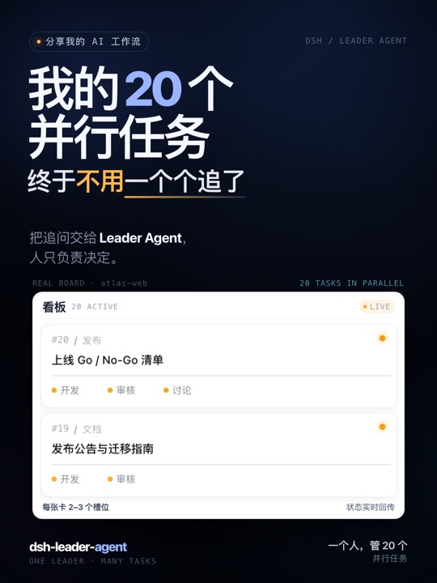

# 2026-11-16 · dsh-leader-agent 宣发

**我同时开发 20 个需求的经验。**

封面只讲这一句：不靠加班，靠把追问交给 Leader Agent。视频开头 9.5 秒是封面段，纯文字、无截图；第一帧可直接给抖音当封面。

## 成品

| 内容 | 位置 |
|---|---|
| 竖屏视频 1080×1920，102.9 秒，60fps | [promo-1080x1920-v5.mp4](https://dsh-agent-leader.oss-cn-beijing.aliyuncs.com/growing/2026-11-16-leader-agent-promo/video/promo-1080x1920-v5.mp4) |
| 单文件交互 HTML（下载后打开；静音预览，无音轨） | [promo-standalone-v5.html](https://dsh-agent-leader.oss-cn-beijing.aliyuncs.com/growing/2026-11-16-leader-agent-promo/html/promo-standalone-v5.html) |
| 旁白 MP3 | [narration-zh-v3.mp3](https://dsh-agent-leader.oss-cn-beijing.aliyuncs.com/growing/2026-11-16-leader-agent-promo/audio/narration-zh-v3.mp3) |
| 封面 9:16（视频首帧） | [cover-9x16-v2.png](https://dsh-agent-leader.oss-cn-beijing.aliyuncs.com/growing/2026-11-16-leader-agent-promo/covers/cover-9x16-v2.png) |
| 封面 3:4 | [cover-3x4-v2.png](https://dsh-agent-leader.oss-cn-beijing.aliyuncs.com/growing/2026-11-16-leader-agent-promo/covers/cover-3x4-v2.png) |
| 源 HTML + 小素材 + 3:4 封面源文件 | [`source/`](source/) |
| 分镜与旁白 / 音频时间轴 / 媒体清单 | [`storyboard.md`](storyboard.md)、[`script.md`](script.md)、[`timeline.json`](timeline.json)、[`media.json`](media.json) |

> 视频、音频、standalone 与全尺寸封面都在 OSS；Git 只保留源文件、文本、索引和 53 KB 预览图。
>
> OSS 标准域名对 HTML 会强制下载（`Content-Disposition: attachment`）；下载后用浏览器打开。要在线预览需给 bucket 绑定自定义域名。

## v3–v5 变更

- **v4/v5 修正**：v4 固定页面 + 等两帧修大字抖动；v5 去掉无源的 `Session 切换 0`（改 `↓`）与 `20+`（改 `20`），S5B/S6 小字放大到 32px，standalone 重生成。渲染方法见 [`source/render-frames.mjs`](source/render-frames.mjs)。
- **S5B 成本提醒**（73.570–83.484）：`Session 切换 ↓` / `Token 花费 ↑`。演示数据没有账单基线，所以只提醒、不给金额；旁白也是先承认不切 Session、再直说 Token 上涨。
- **S7 提问**（95.602–102.888）：`大家平时，用什么多 Agent 编排系统？` 评论区聊聊。
- S4B 保留修正：**卡片是任务，不是会话**；同一任务背后可能跑多个 Worker Agent 会话。
- 封面未重做：S0 未变，9:16 / 3:4 用 v2。

## 事实

- 画幅 1080×1920，60fps，H.264 + AAC；总长 **102.888 秒**。
- 旁白 11 段；s5b 与 s7 单独合成，其余沿用 v2 录音。
- 叙事：经验封面 → 5 个任务压过来 → 人成了阻碍点 → Leader Agent 接管 → 输入/卡片/汇报 → 结果 → **成本提醒** → DeepSeek Harness 安装 → **提问**。
- 全片角色名统一 `Leader Agent`；结尾安装命令为 `dsh plugin --profile web add dsh-leader-agent`。

## 媒体

- Bucket：`dsh-agent-leader`（`oss-cn-beijing`，公共读，专用 bucket）
- 前缀：`growing/2026-11-16-leader-agent-promo/`
- v3 新增旁白/standalone，v4 只新增视频，v5 新增视频与 standalone；音频沿用 v3、封面沿用 v2，v1–v4 保留。
