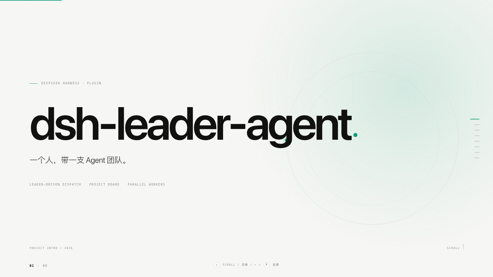

# 2026-11-19 · 项目介绍 HTML Deck

**一句话：一个人，带一支 Agent 团队。**

面向第一次听说 `dsh-leader-agent` 的人：8 页讲完「它是什么、主要功能、和 Harness Agent Team 模式的差别」。

## 成品

| 内容 | 位置 |
|---|---|
| 成品 HTML（单文件、无外部依赖） | [deck-1600x900-v1.html](https://dsh-agent-leader.oss-cn-beijing.aliyuncs.com/growing/2026-11-19-project-intro/html/deck-1600x900-v1.html) |
| 可编辑源 HTML（与成品同字节） | [`source/deck.html`](source/deck.html) |
| 封面预览 1600×900 | [`preview.jpg`](preview.jpg) |

打开方式：下载成品后用浏览器打开；改版直接改 `source/deck.html`。方向键 / 空格 / PageUp / PageDown 翻页，`F` 全屏，右侧细线可跳页；移动端改为纵向滚动。HTML 在 OSS 上强制下载，原因见 [`../AGENTS.md`](../AGENTS.md)。

## 叙事

1. **封面**：`dsh-leader-agent`，一个人带一支 Agent 团队。
2. **它是什么**：你只跟 Leader 说目标，拆解、派工、盯完成、收产物交给它。
3. **并行**：worker 是常驻根会话，一人一个 worktree，turn 结束自动结算。
4. **看板**：一个项目一块看板，卡片 + 槽位 + 信号灯，点槽位直接下钻。
5. **编排**：`LEADER.md` / `SLOTS.md` / `leader-mode`，改文件即改行为。
6. **介入**：下钻、只读回看、15 分钟无回报巡查。
7. **对比**：项目 vs 会话、根会话 vs subagent、worktree vs 共享检出、卡片 vs 共享任务板。
8. **收尾**：安装命令与仓库地址。

## 取舍

- **视觉**：ChatGPT 式极简科技风——暖白底、黑字、大留白，只留一处品牌绿做点缀（圆点、信号灯、hairline）。
- **少字**：每页一个观点；图上能说清的，不写第二段。
- **可编辑**：单文件 HTML + 内联 CSS/JS，不依赖字体、CDN 或构建。
- **对比要公平**：Agent Team 是运行时协作原语，本 bundle 是面向交付的编排层；两者定位不同，不建议同时启用。

## 状态

已上传 OSS（`html/deck-1600x900-v1.html`），身份字段见 [`media.json`](media.json)；`source/deck.html` 只是可编辑源。
